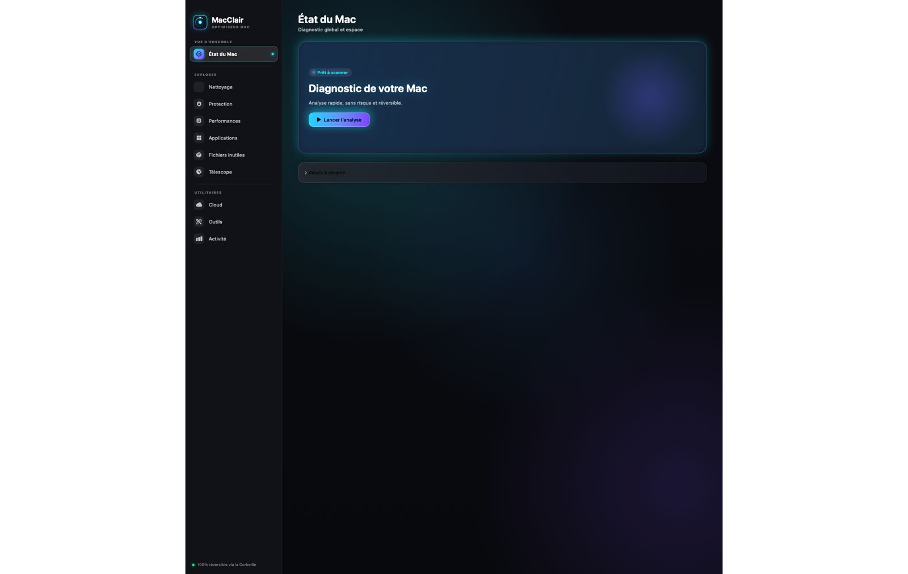

# MacClair

**Français** · [English](README.md)

    

MacClair est une application macOS libre, en français et en anglais, pour examiner l’espace disque et déplacer prudemment des fichiers personnels vers la Corbeille. L’interface s’inspire de la catégorie des utilitaires de nettoyage Mac, mais le code, les textes et l’icône sont originaux. La version actuelle **ne possède pas toutes les fonctionnalités de CleanMyMac** et n’a pas subi le même niveau de validation.

MacClair privilégie les analyses locales et les opérations explicites : tout fichier déplacé part à la Corbeille, où il peut être restauré, et chaque action est confirmée.


**Site web :** [macclair.waaplink.com/fr](https://macclair.waaplink.com/fr) · et `brew install --cask n-khd/tap/macclair`



*L’interface réelle, rendue par l’application elle-même — en français et en anglais.*

## Télécharger

Trois façons, au choix :

**Homebrew** (mises à jour gérées par `brew upgrade`)

```sh
brew install --cask n-khd/tap/macclair
```

**DMG** — téléchargez le `.dmg` de la dernière version depuis la page [Releases](../../releases), ouvrez l’image et glissez `MacClair` dans le dossier Applications.

**Zip** — téléchargez le `.zip` de la dernière version, décompressez-le et déplacez `MacClair.app` dans le dossier Applications.

Les archives sont **universelles** — Apple Silicon **et** Intel — pour macOS 14 ou plus récent. Le code source est également téléchargeable depuis la même page.

### Signature et notarisation

Les archives ZIP à partir de la version 0.5.1 et les DMG à partir de la version 0.5.2 sont signés avec un certificat **Developer ID Application** et **notariées par Apple** ; le ticket de notarisation est agrafé dans l’application. macOS peut ainsi vérifier leur provenance et leur notarisation.

Pour vérifier l’intégrité du téléchargement, comparez la somme SHA-256 de l’archive avec le fichier `SHA256SUMS` de la même release :

```sh
shasum -a 256 MacClair-*.dmg
```

Les builds sont produits par le workflow GitHub Actions `.github/workflows/release-notarized.yml` (compilation, signature Developer ID, notarisation Apple, agrafage, contrôle `spctl`, publication). L’archive 0.5.0, plus ancienne, était seulement signée ad hoc et nécessitait un contournement manuel de Gatekeeper.

### Mises à jour

À partir de la version 0.6.0, MacClair se met à jour toute seule via [Sparkle](https://sparkle-project.org) : elle vérifie le flux signé `appcast.xml`, prévient quand une version plus récente existe et l’installe. La vérification manuelle est dans le menu **MacClair › Rechercher des mises à jour…**.

Chaque mise à jour est authentifiée par une signature EdDSA (clé publique dans `SUPublicEDKey` de l’Info.plist) : un binaire modifié ou un flux détourné est refusé, macOS vérifie en plus la signature Developer ID et la notarisation avant de remplacer l’application.

## Utiliser MacClair avec un agent MCP

Les versions construites avec ce serveur incluent `macclair-mcp` dans l’application. Le client lance ce processus local à la demande : aucune adresse réseau ni clé API n’est nécessaire. Installez d’abord MacClair 0.7.0 ou plus récente dans `/Applications` : `macclair-mcp` est inclus dans l’application depuis cette version.

La sécurité est volontairement fermée : `move_to_trash` exige un jeton **et** le chemin exact confirmé par l’utilisateur, puis affiche une alerte native avant tout déplacement. Toute demande hors de `~/Téléchargements`, sur un lien symbolique ou sur un fichier modifié depuis la préparation est refusée.

Pour Codex :

```sh
codex mcp add macclair -- /Applications/MacClair.app/Contents/MacOS/macclair-mcp
```

Pour Claude Code :

```sh
claude mcp add --transport stdio --scope user macclair -- /Applications/MacClair.app/Contents/MacOS/macclair-mcp
```

Redémarrez le client si nécessaire, puis demandez-lui par exemple « analyse mes doublons dans Téléchargements ». Les commandes et leur portée sont décrites dans les documentations [Codex](https://developers.openai.com/codex/mcp) et [Claude Code](https://code.claude.com/docs/en/mcp). Si l’application est installée ailleurs, adaptez le chemin. Pour une compilation locale, remplacez `/Applications/MacClair.app` par le chemin absolu vers `dist/MacClair.app`.

Le serveur expose deux analyses (`scan_downloads`, `scan_cleanup`) ainsi que `prepare_trash` et `move_to_trash`. Le déplacement exige un jeton préparé dans la même session et une confirmation macOS pour chaque fichier ; un fichier modifié depuis sa préparation est refusé. Seuls les fichiers ordinaires admissibles de Téléchargements peuvent être déplacés. Cette opération ne garantit pas qu’une autre copie du fichier existe : vérifiez le chemin et conservez une sauvegarde.

Les résultats contiennent des noms et chemins potentiellement personnels : ils sont transmis au client et peuvent être envoyés à son fournisseur selon ses réglages. Les autorisations macOS du processus client et les limites des analyses peuvent rendre les résultats incomplets. Le serveur ne contourne pas les protections du système.

## Langue de l’interface

L’interface est disponible en **français** et en **anglais**. Par défaut, MacClair suit la langue de macOS ; vous pouvez la forcer dans le menu **MacClair › Langue / Language**. Les textes techniques (chemins, identifiants) ne sont jamais traduits.

## Fonctions disponibles

- Vue d’ensemble et analyses locales.
- Caches, journaux et anciens installateurs du compte : déplaçables vers la Corbeille après confirmation (éléments de plus de 30 jours).
- Inventaire en lecture seule de l’état des protections macOS, des applications, des agents de démarrage, du stockage et des dossiers cloud présents localement.
- Inventaire local ciblé des caches Safari, Chrome et Firefox et des dossiers « Mail Downloads » accessibles, avec limites et erreurs signalées. Il ne couvre pas tous les navigateurs ni toutes les pièces jointes Mail.
- Liste des gros fichiers, des installateurs, des doublons exacts et des images ressemblantes avec noms et chemins réels.
- Préparation automatique des copies supplémentaires des doublons, avec une copie conservée par groupe et confirmation unique avant déplacement.
- Déplacement vers la Corbeille des fichiers sélectionnés, uniquement dans `~/Downloads`.
- Télescope pour examiner un dossier choisi, sans suivre les liens symboliques.

L’analyse générale est ciblée : elle examine les fichiers de Téléchargements (ou d’un sous-dossier choisi), inventorie les caches et journaux du compte et les installateurs de plus de 30 jours, puis relève les applications et l’état de certaines protections macOS. Elle ne recherche pas les malwares et ne parcourt pas l’ensemble du disque. La recherche de doublons exclut les dossiers cachés, paquets et certains dossiers de projets ; comparer le contenu complet de très gros fichiers peut prendre du temps. Elle est limitée à 10 000 fichiers et 80 000 entrées ; l’inventaire des fichiers anciens est limité à 20 000 résultats par catégorie. Les limites et les erreurs d’accès sont signalées dans l’interface et peuvent rendre les résultats incomplets. Une analyse rapide peut donc être normale et ne signifie pas que tout le Mac a été vérifié.

L’interface ne présente que des fonctions réellement disponibles ; les fonctions non implémentées ne sont pas affichées. Voir la [feuille de route](ROADMAP.md) pour le périmètre actuel et les écarts.

## Utiliser les doublons

1. Ouvrez **Mes fichiers inutiles** et lancez l’analyse.
2. Dans **Doublons**, cliquez sur **Nettoyer les doublons en lot…**. MacClair prépare les copies en trop et conserve une copie de chaque groupe.
3. Examinez les noms et chemins, puis confirmez le déplacement vers la Corbeille. Les groupes répartis entre plusieurs dossiers ou situés dans des projets sont ignorés par défaut.

## Sécurité et limites

MacClair n’efface aucun fichier système et n’exécute aucune commande de maintenance. Le déplacement vers la Corbeille est limité aux fichiers ordinaires dans `~/Downloads`. Avant l’opération, l’application contrôle notamment le chemin, le type de fichier, l’inode, le volume, la taille et la date de modification. Les liens symboliques, les dossiers cachés, les composants internes de dépôts Git et les paquets d’applications sont rejetés. Les caches, journaux et installateurs sélectionnés sont déplacés vers la Corbeille (jamais effacés définitivement) après confirmation explicite.

Ces contrôles réduisent le risque sans garantir une sécurité absolue. L’application n’a pas fait l’objet d’un audit indépendant et ne protège pas encore de manière atomique contre toutes les modifications concurrentes du système de fichiers. Vérifiez la sélection avant de confirmer et gardez une sauvegarde de vos données importantes.

## Compiler et tester

Prérequis : macOS 14 ou plus récent et Xcode ou les outils de ligne de commande Apple avec Swift 6. La compilation utilise le SDK macOS installé localement et cible l’architecture du Mac utilisé ; `MACCLAIR_ARCHS="arm64 x86_64" ./build-app.sh` produit un binaire universel.

```sh
./test.sh
./build-app.sh
open dist/MacClair.app
```

L’application compilée se trouve dans `dist/MacClair.app`. Le script applique une signature ad hoc pour le développement local. Il ne réalise ni signature Developer ID ni notarisation.

## Journal des versions

Voir [CHANGELOG.md](CHANGELOG.md).

## Participer

MacClair est petit exprès — environ 4 400 lignes de Swift, aucune dépendance, un script de
compilation — donc une première pull request peut aboutir dans l'heure. Tout est utile : une
traduction, un bug reproductible, un test sur un Mac que le mainteneur n'a pas, ou du code.

- **[Premières issues](https://github.com/n-khd/MacClair/labels/good%20first%20issue)** — des tâches
  cadrées, avec le fichier à toucher et le résultat attendu.
- **[CONTRIBUTING.fr.md](CONTRIBUTING.fr.md)** — compiler et tester, carte du code, règles de sécurité
  à ne pas casser, déroulé de la revue. In English: [CONTRIBUTING.md](CONTRIBUTING.md).
- **[docs/ARCHITECTURE.md](docs/ARCHITECTURE.md)** — comment le scanner, la porte de sécurité de la
  Corbeille et le serveur MCP s'articulent.
- **[docs/TRANSLATING.md](docs/TRANSLATING.md)** — ajouter une langue avec un seul fichier, sans Swift.
- **[Discussions](https://github.com/n-khd/MacClair/discussions)** — questions et idées en vrac.

Pour une vulnérabilité, suivez [SECURITY.md](SECURITY.md) — jamais une issue publique. En
participant, vous acceptez le [code de conduite](.github/CODE_OF_CONDUCT.md). Le code et les
ressources sont sous [licence MIT](LICENSE). MacClair est un projet indépendant, non affilié à MacPaw.
