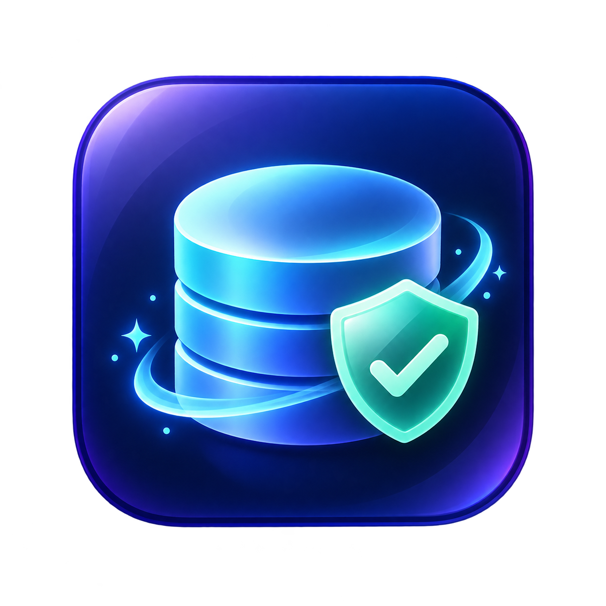

# MacClair

**English** · [Français](README.fr.md)

MacClair is a free, open-source macOS utility that maps your disk usage and moves personal files to the Trash — carefully. It sits in the same category as the commercial Mac cleaners, but the code, the wording and the icon are original. It does **not** implement every feature of CleanMyMac, and it has not been through the same level of validation.

Everything is local and explicit: every file that leaves its place goes to the Trash, where it can be restored, and every action is confirmed. No account, no telemetry, no network call.



## Install

Three ways, pick one.

**Homebrew** (updates handled by `brew upgrade`)

```sh
brew install --cask n-khd/tap/macclair
```

**DMG** — download `MacClair-<version>-macOS-arm64.dmg` from the [Releases](https://github.com/n-khd/MacClair/releases) page, open the image and drag `MacClair` into Applications.

**Zip** — download `MacClair-<version>-macOS-arm64.zip`, unzip it and move `MacClair.app` into Applications.

All builds target Apple Silicon Macs running macOS 14 or later. The source code is on the same release page.

### Signed and notarized

Every release is signed with a **Developer ID Application** certificate and **notarized by Apple**; the notarization ticket is stapled inside the app. macOS can therefore verify both the origin and the notarization — no Gatekeeper warning, no `xattr` trick, no right-click workaround.

To check the integrity of a download, compare its SHA-256 with the `SHA256SUMS` file of the same release:

```sh
shasum -a 256 MacClair-0.8.0-macOS-arm64.dmg
```

Builds are produced by `.github/workflows/release-notarized.yml` (compile, Developer ID signature, Apple notarization, stapling, `spctl` check, publishing).

### Updates

MacClair updates itself through [Sparkle](https://sparkle-project.org): it reads a signed `appcast.xml` feed, tells you when a newer version exists and installs it. Manual check: **MacClair › Check for updates…**.

Every update is authenticated by an EdDSA signature (public key in `SUPublicEDKey`) on top of the Developer ID signature and notarization, so a modified binary or a hijacked feed is refused.

## Language

The interface ships in **French** and **English**. By default MacClair follows the macOS language; you can force it in the **MacClair › Langue / Language** menu. Technical strings (paths, bundle identifiers) are never translated.

## Use MacClair from an MCP agent

The app bundles a local MCP server, `macclair-mcp`. Your client launches that process on demand: no network address, no API key. Install MacClair 0.7.0 or later in `/Applications` first — `macclair-mcp` is included in the app from that version.

```sh
# Codex
codex mcp add macclair -- /Applications/MacClair.app/Contents/MacOS/macclair-mcp

# Claude Code
claude mcp add --transport stdio --scope user macclair -- /Applications/MacClair.app/Contents/MacOS/macclair-mcp
```

Restart the client if needed, then ask something like “find duplicates in my Downloads”. For a local build, use the absolute path to `dist/MacClair.app` instead.

Security is deliberately strict: `move_to_trash` requires a prepared token **and** the exact path the user confirmed, then shows a native alert before anything moves. Anything outside `~/Downloads`, a symbolic link, or a file modified since it was prepared is refused.

The server exposes two read-only scans (`scan_downloads`, `scan_cleanup`) plus `prepare_trash` and `move_to_trash`. Results contain file names and paths, which are personal data: they go to the client and may be forwarded to its provider depending on your settings.

## What it does

- Overview and local scans of your own account.
- Caches, logs and old installers (older than 30 days) of your account, movable to the Trash after confirmation.
- Read-only inventory of macOS protections, installed applications, launch agents, storage and locally present cloud folders.
- Targeted local inventory of Safari, Chrome and Firefox caches and reachable “Mail Downloads” folders, with limits and errors reported.
- Large files, old installers, exact duplicates and similar images, with real names and paths.
- Automatic preparation of redundant duplicate copies, keeping one copy per group, with a single confirmation before moving.
- Trash moves for selected files, restricted to `~/Downloads`.
- A telescope view to inspect a chosen folder without following symbolic links.

The general scan is focused: it looks at Downloads (or a chosen subfolder), inventories your account’s caches and logs and installers older than 30 days, then reports applications and the state of some macOS protections. It does not hunt malware and does not walk the whole disk. Duplicate search skips hidden folders, packages and some project folders; comparing very large files in full can take a while. It is capped at 10,000 files and 80,000 entries, and the old-files inventory at 20,000 results per category. Limits and access errors are reported in the interface and can make results incomplete.

See [REVERSE_ENGINEERING.md](REVERSE_ENGINEERING.md) and [ROADMAP.md](ROADMAP.md) for what is implemented today and what is not.

## Duplicates

1. Open **Unneeded files** and run the scan.
2. In **Duplicates**, click **Clean duplicates in bulk…**. MacClair prepares the redundant copies and keeps one copy per group.
3. Review the names and paths, then confirm the move to the Trash. Groups spread over several folders, or inside projects, are skipped by default.

## Safety and limits

MacClair never deletes a system file and never runs a maintenance command. Trash moves are restricted to regular files inside `~/Downloads`. Before acting, the app checks the path, the file type, the inode, the volume, the size and the modification date. Symbolic links, hidden folders, internal Git components and application packages are rejected. Selected caches, logs and installers are moved to the Trash (never deleted for good) after an explicit confirmation.

These checks reduce risk; they do not guarantee absolute safety. The app has not been independently audited and does not yet protect atomically against every concurrent filesystem change. Review your selection before confirming, and keep a backup of important data.

## Build and test

Requirements: macOS 14 or later, plus Xcode or the Apple command-line tools with Swift 6. The build uses the locally installed macOS SDK and targets the architecture of the current Mac.

```sh
./test.sh
./build-app.sh
open dist/MacClair.app
```

The built app lands in `dist/MacClair.app`. The script applies an ad-hoc signature for local development; it does no Developer ID signing and no notarization.

## Contributing

Issues and proposals are welcome in GitHub issues. For contributions see [CONTRIBUTING.md](CONTRIBUTING.md); to report a vulnerability see [SECURITY.md](SECURITY.md). Code and assets are released under the [MIT license](LICENSE). MacClair is an independent project and is not affiliated with MacPaw.
